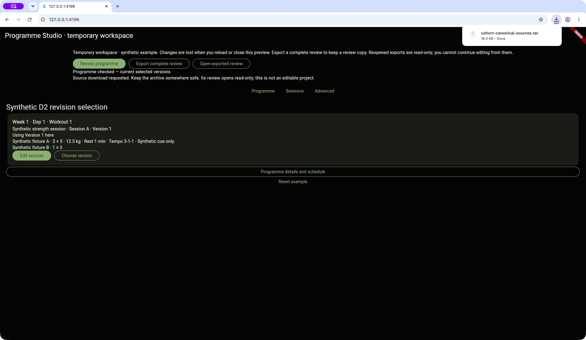

# Canonical source download — continuation checkpoint

2026-10-17. **IMPLEMENTED_TECHNICALLY_VERIFIED_READY_FOR_NORMAL_PUBLICATION**.
[Scope and acceptance](SCOPE.md). Founder's latest authority includes this local
implementation, autonomous routine choices/checks and normal main integration when
technical gates pass. No additional founder walkthrough gate was introduced for the
standard file download. Agent Chrome checks do not imply founder content approval.

## Published first

Programme-first usability was explicitly founder-accepted and integrated normally:
0767ac6a80fc6611598b9ca5f2c991d3f76125a6 →
4d78d4681a1f8a64771f7fbf05f5597cfe77b3cc, four linear preserved commits, zero merges.
Refetched remote SHA equalled clean integration HEAD, divergence 0/0. Acceptance is
[recorded durably](../programme_studio_programme_first_usability/FINAL_REVIEW_AND_ACCEPTANCE.md).
The older uncertain strength-lineage feedback remains historical, not rewritten.

## Built next

Worktree: `/Users/leewebber/.codex/worktrees/studio-canonical-source-export/cohort_platform`

Branch: `codex/studio-canonical-source-export`; base is the published 4d78d468 above.
Implementation: `2c2fa6e9fe8c4c6c5d3dec31d967758adca43db0`.
The commit introducing this handoff is its final documentation child; resolve its SHA
from Git. Both commits are preserved linearly for normal main-only publication.

The existing Export complete review summary now offers Download canonical sources.
After fresh joint validation and final exact-receipt/bytes consumption checks, Chrome
requests one standard deterministic TAR archive containing:

- `programme.plan-package.yaml`: exact current canonical programme source.
- `sessions/session-a-vN.founder.yaml` / `session-b-vN.founder.yaml`: exact source of
  every declared revision, including unused versions/roots; excludes private saves/drafts.
- `review.json`: unchanged complete transport-v1/v2 for separate read-only reopen.
- `source-index.json`: derived full identity/profile/exercise-version/digest bindings.
- `README.md`: plain limits and the unchanged local operator compiler command.

This advances Stage 2's explicit canonical-file output workflow. Filenames use fixed
lineage policy + revision, never titles or authored paths. The archive has stable order,
zero times/owner IDs and UTF-8 bodies. No dependency, import, schema, writer, profile,
identity, allocator, transport or production route changed. TAR/index are derived
containers, never a new Studio source authority or trusted archive intake format.

No live owner, selection or reservation changes during download/reopen. Current live
or separate reconstructed receipts are supported. Changed owners/reset/disposal invalidate
consumption. Callback-triggered reset cannot report late success. Unsupported platforms
retain copy-review recovery. The success text says download *requested*, not proof of
user retention. Browser code only creates/clicks/removes a local download anchor.

A first broad test run caught the new directory crossing the existing D2/composition
import boundary. Moved the new code inside composition/source_export; isolation tests
were retained unchanged and pass. No additional product defect or relaxed boundary.

## Verification and evidence reuse

[Verification/protected-artifact receipt](VERIFICATION.json) and
[checkout preservation](PRESERVATION.json) retain exact counts/hashes.

- 252 current Studio tests passed, including seven new file/consumption/UI tests.
  Standard system tar independently extracts both A-only and two-lineage archives;
  existing compiler and exact source/profile bindings pass for every exported file.
  Tests cover unused/private versions, same-title R1 identities, UTF-8, immutable bytes,
  deterministic reopen/archive regeneration, forged receipts and stale downloads.
- 19 focused export/programme-first tests passed. Fresh six unchanged safety groups pass.
- Zero diagnostics in eight new/changed Dart files. Fresh full analysis before/after has
  367 identical inherited diagnostics: 110 warnings, 257 info, zero errors; non-green,
  exit 1. No unrelated warning cleanup or suppression.
- Reused the accepted 41-test canonical-package result: its raw log hash still matches,
  and every file in packages/cohort_plan_package is unchanged. No redundant suite rerun.
  Existing importer/shared identity code is also unchanged; fresh Studio tests cover
  their composed use and old D1/D2, transport/tampering and isolation compatibility.
- All 2,680 baseline entries outside the four-file existing-file allowlist are unchanged
  (including nine absent skip-worktree .temp objects). Shared compiler/schema/hash,
  resolver/allocator, source fixtures/writers/profile, transport, published artifacts,
  v1/v2 goldens, dependencies, safety scripts and isolation test definitions protected.
- Before/after inventories match all nine older checkouts, including original main's
  95 outstanding paths, HEADs, indices and .temp. No older checkout was written.
- Diff and changed-document local links checked; no external link contact.

Actual Chrome download: `cohort-canonical-sources.tar`, 18,432 bytes, SHA-256
`13ac453bb86147ca6d568f5914fbdd96b0ea065eb5aba21272307a43ce93fa42`.
Python tarfile independently extracted it; every file/index/review digest agreed.
The unchanged operator CLI compiled the extracted programme to
`6eff96f2d89265236e57bf93642c0e6ba9bcabe5974b97209e5c5969a865b40a`, sessions=1,
matching review/index. This is fixture output, not a published real programme.



## Preview and continuation

Local Chrome preview: <http://127.0.0.1:4196/>. Existing accepted preview on 4195 was
not disturbed. New candidate hot-restarted and Chrome reloaded to the clean A-only
seed. No further manual founder task is needed for this bounded file-download action.
To inspect: Export complete review → Download canonical sources; extract the archive.

```bash
flutter --suppress-analytics run -d chrome --web-hostname 127.0.0.1 --web-port 4196 --no-pub -t lib/main_programme_studio_composition_preview.dart
```

Runtime/evidence: `/private/tmp/cohort-studio-continuation/`. Final normal main push and
refetched equality/divergence/clean-state proof are reported in the task result and local
publication receipt. Do not advance dirty original main or rewrite older evidence.

## Remaining requirements and working preference

Keep momentum: implement coherent practical authoring improvements under the current
founder authority, use valid evidence, and avoid recurring allocation-only/test approval
cycles. Pause only for the latest user's listed material decision/contract/security/
out-of-authority/unsatisfied mandatory-gate conditions. Do not infer real content from
fixtures or invent coaching prescriptions.

[Studio §§3/5](../../architecture/Programme_Studio_v1.md) requires controlled canonical
source generation. File output now exists; broad intake, first real authoring use case,
needed schedule/representation/locked-declaration coverage and durable editable project
restoration remain unsatisfied/unallocated. A review file/archive does not resume editing.
No universal Stage 2 closure checklist is invented. Optional wider lineage/profile
frameworks have no concrete justification here.

[Launch library §10](../../architecture/Launch_Programme_Library_v1.md) and
[product plan §4](../../planning/Athlete_Product_Completion_Plan_v1.md) still require
complete authored real progression/policies/canonical identities, editorial/coaching
approval, technical compilation and real-world quality gates. Supplying those sources
does not necessarily require an editor for every locked declaration. Broader Stage 2/
Sprint C and four genuine-record-dependent phone checks remain open.

A practical next decision is the first source-backed authoring use case and its exact
coverage; durable editable authoring may then be built against that requirement. Do not
expand fixtures as a substitute. No hosted mutation, real publication, athlete change,
payment, destructive operation or device distribution occurred or follows from this slice.
