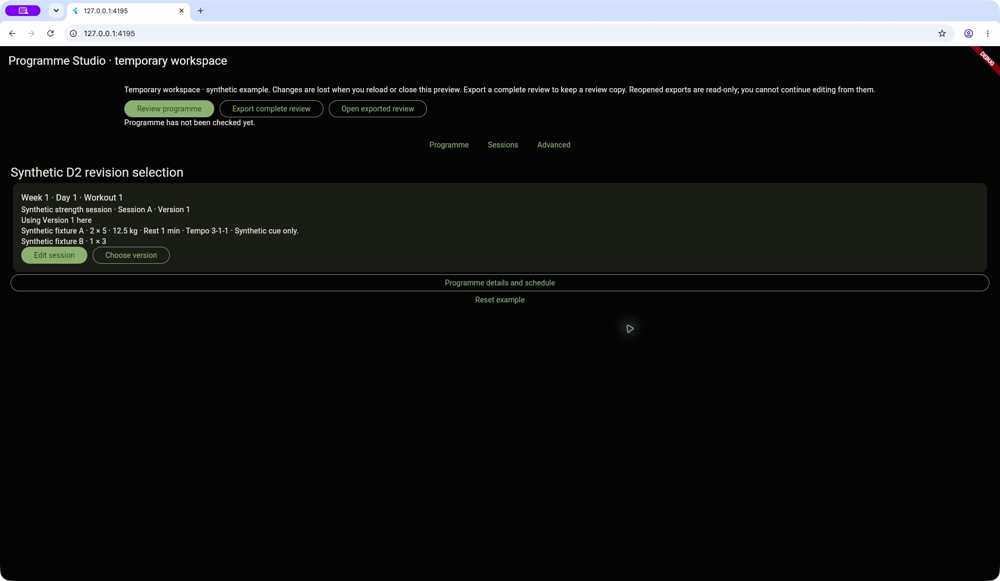

# Programme-first Studio usability — local handoff

2026-10-17. **IMPLEMENTED_LOCALLY_AWAITING_FOUNDER_VISUAL_USABILITY_REVIEW**.
No integration, fetch or push. Published base remains
`0767ac6a80fc6611598b9ca5f2c991d3f76125a6`; cached refs are not a fresh remote check.

## Authority and current limits

The founder approved the complete [allocation](APPROVED_ALLOCATION.md), with the
[implementation approval/product decision](APPROVAL.md). Temporary authoring and a
complete **read-only** export/reopen are acceptable for this milestone only. They do
not satisfy durable editable authoring or establish Stage 2 or launch readiness.
The next real authoring use case remains unallocated and does not block this slice.

Earlier founder feedback remains qualified: functionality tentatively observed;
detailed manual outcomes uncertain; workflow confusing and not user friendly;
full visual/usability acceptance NOT granted. Neither those observations nor the
agent's current checks constitute acceptance of this milestone. Stop here for founder
review. Broader Stage 2/Sprint C and four record-dependent phone checks remain open.

Worktree: `/Users/leewebber/.codex/worktrees/studio-programme-first-usability/cohort_platform`

Branch: `codex/studio-programme-first-usability`.

Local allocation commit: `a7e7b07e3b8618ae0111c98a3892029f2ca93dc3`.
Implementation commit: `b4a95f2b092d0723e26899105abdbe728ae5e21f`.
The final documentation commit follows these; resolve branch HEAD for its full SHA.
All are local and linear from the exact base.

## Delivered workflow

Programme workout cards show the selected Session A/B and actual version, prescription,
Edit session and Choose version. Saving uses the existing D2 exact-byte validation and
immutable freeze behind Save new version. It explicitly leaves programme selection
unchanged. Known invalid fields show actionable messages beside the input; the save
failure focuses/scrolls to the field, preserves input, and retains raw diagnostics in
Advanced. No-op saves remain refused. Existing abandoned-number rules remain intact.

Use this version… prepares a verified candidate before presenting the named workout,
current/new prescription and newly available versions. Only Use version here gives
consent. Keep current version/cancellation makes neither admission nor selection change.
The optional Add to programme without changing workouts remains separate.

Version cards distinguish saved/private and excluded, available/unused and included,
and used in named workouts. Titles are display only; full tuple keys remain authoritative.
Session A/B subtitles distinguish same titles and version numbers. Existing schedule
controls allocate unique required-slot keys internally against current keys/templates.
Authors do not invent keys. Standalone D1/D2 defaults remain compatible.

Review programme validates all selected slot bodies and opens the existing Studio
prescription review directly. Export complete review explains the inventory before
copying: every declared added version, including unused versions and both roots when
B is declared; private saved versions/drafts are excluded and named as such. Open
exported review opens a separate read-only Studio prescription view with an included
version list. It does not replace the live workspace, resume editing or restore history.
Temporary-workspace and read-only limitations remain visible. The original technical
composition interface remains accessible under Advanced.

## Atomicity and lifecycle findings

The old separate admission/selection methods could not supply atomic use-version consent.
The existing catalogue now prepares a checked detached append; the existing D1 controller
prepares the exact target-slot tree with those references. Composition verifies the exact
owner-retained frozen revision(s), recompiles exact source/profile/bindings, checks all
prospective slots through the existing composition review, then exposes an opaque receipt.

Commit rechecks receipt ownership, both-owner workspace generation, programme revision
and exact source, catalogue epoch, target and retained object identity. Catalogue and
programme tree install synchronously before one D1 notification, with no await/observer
between them. Failure/cancellation during preparation commits neither side; the frozen
version remains available for retry. A B descendant stages its genuine missing root too.
No second catalogue/editor, rollback of frozen history or relaxed trust policy was added.

Tests cover late preparation failure, other-owner edits, notification-triggered reset/
disposal, newer pending validation, moved slots and stale confirmations. Relevant D1/D2
confirmation hooks also capture workspace generations. Export checks the exact current
receipt and bytes again at consumption. A final review fix prevents a platform clipboard
completion after reset/edit from closing the stale dialog or announcing late success.
A clipboard write already dispatched to the platform cannot be recalled; freshness is
checked before dispatch and again before reporting completion.

Old technical composition widget tests explicitly select the retained Advanced surface;
new outcome tests exercise the default programme-first interface. Existing controller,
transport-v1/v2, identity, tampering and standalone tests still run. No transport version
or compiler policy change was needed.

## Fresh verification

[Machine-readable verification](VERIFICATION.json), [protected artifacts](PROTECTED_ARTIFACTS.json)
and [older checkout preservation](PRESERVATION.json) record commands, counts and hashes.

- 411 affected root tests passed, including 30 new orchestration/widget regressions.
- 12 author-facing widget tests passed, included in the 411 total.
- 41 canonical-package tests passed.
- All 10 changed/new Dart files: zero diagnostics.
- Fresh full analysis before/after: **367 identical diagnostics; 110 warnings, 257 info,
  zero errors; exit 1, non-green**. No diagnostic additions/removals, exclusions or
  suppressions. An introduced brace-style info found during development was corrected.
- All six unchanged safety groups passed: architectural boundaries, coaching integrity,
  adaptation contracts, programme adaptation UI, completion identity, staging/production
  isolation. An outside-repository wrapper only adds cached `--no-pub`/analytics options.
- Baseline has 2,670 Git entries. All 2,662 outside the explicit eight-file existing-file
  allowlist retain their bytes/objects. Shared compiler/schema/hash, canonical resolver/
  revision allocator, original A seed, fixtures/profile, writers, transport, published
  artifacts, v1/v2 goldens and safety definitions are unchanged.
- All seven older inventories compare exactly, including original main's 95 outstanding
  paths, HEADs, indices, Git pointer files and .temp. No older checkout was written.
  Inventories cover tracked/nonignored paths plus all present .temp files; ignored build
  caches were not inventoried or modified. Nine inherited absent skip-worktree .temp Git
  entries retain their objects and were not restored.
- Full-range diff and local Markdown links checked; link result in CHECKS.json.

Agent Chrome inspection exercised first-exercise reps 5 → 6, saving while retaining
Version 1, explicit use of Version 2, actual readable review, complete copy and separate
read-only reopen with Version 1 retained as unused. Clean A-only Version 1 seed restored,
then hot-restarted from committed implementation. This is agent evidence only.



[Actual read-only reopen screenshot](chrome-reopen.jpg) records the 6-rep agent exercise.
The [earlier allocation image](observed-readonly-review.png) is historical inspection
of the previous workflow, not the new candidate.

## Preview and short founder task

Preview is left running at <http://127.0.0.1:4195/> in Chrome, clean A-only seed.
Loopback only; existing composition preview entry remains separate from production.

1. In Week 1 · Day 1 · Workout 1, see Session A · Version 1 and 2 × 5 reps.
   Click Edit session. Change the first exercise's Exact reps from 5 to 6, then
   Save new version. The save result must say the programme still uses the old version.
2. Use this version… shows the named workout and 5 → 6 prescription change.
   Keep current version once if desired; Choose version lets you return. Deliberately
   confirm Use version here. The card must now clearly use Version 2.
3. Review programme. Find 2 sets · 6 reps, 12.5 kg, Rest 1 min, Tempo 3-1-1 and
   Synthetic cue only. The second exercise remains 1 set · 3 reps.
4. Back in the workspace, Export complete review → Copy review export. Open exported
   review, paste the complete copied text, and Open read-only review. Check the same
   prescription, Included versions (2), and read-only notice. You cannot continue editing
   from that copy. No tuples, digest, YAML or catalogue inspection is needed.

Optional error check: clear the first reps field, Save new version, then correct it from
the visible field message. Record outcomes and assistance separately. In particular,
record whether the temporary-workspace/read-only limitation is understood and whether
the workflow feels clear. Do not translate tentative feedback into a pass.

Established local restart command, from this worktree (only when no unrelated listener
owns the port):

```bash
flutter --suppress-analytics run -d chrome --web-hostname 127.0.0.1 --web-port 4195 --no-pub -t lib/main_programme_studio_composition_preview.dart
```

Uses already installed tools and cached local package metadata; no pub get/device build.
Do not stop unrelated processes. Reload/hot restart intentionally clears transient edits.
Runtime logs/evidence live in `/private/tmp/cohort-programme-first-usability/`.

## Remaining product coverage

[Studio Stage 2](../../architecture/Programme_Studio_v1.md) requires controlled authoring
that emits existing canonical Plan Package/protocol sources without a parallel store.
This slice improves the accepted bounded D1/D2/composition capability; one week, two fixed
synthetic owners, straight sets and a fixed profile do not establish complete coverage.
The first real authoring use case, needed schedule/source/representation coverage and
treatment of locked declarations remain unallocated. Durable editable authoring remains
unsatisfied; its necessity/design must be selected as a product requirement, not silently
inferred from the complete read-only review transport.

[Launch library requirements](../../architecture/Launch_Programme_Library_v1.md) and the
[product plan](../../planning/Athlete_Product_Completion_Plan_v1.md) still require real
complete canonical content/progression/policies, exercise identity, editorial/coaching
approval and compile/review/real-world quality gates. They do not require every locked
canonical declaration to have an editor; existing operator paths remain valid. Real
content, hosted publication, athlete/production wiring and release/device gates remain
separate. More synthetic lineages, broader profile trust and generic catalogue frameworks
are optional without a concrete need. No next implementation is authorised here.

No real content, persistence service, hosted operation, production wiring, migration,
tracking expansion, v2 running editing or device work was performed. Founder visual/
usability review remains the next gate for this bounded milestone.
